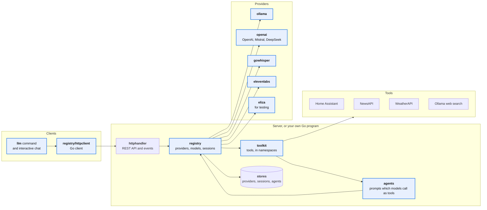

# go-llm

[](https://pkg.go.dev/github.com/mutablelogic/go-llm)
[](LICENSE)

go-llm is a server, command-line tool and Go SDK which puts large language models and speech models from several providers behind one interface. You add providers, such as Ollama, OpenAI, Mistral, [go-whisper](https://github.com/mutablelogic/go-whisper) and ElevenLabs, and then ask any of their models to reply to messages, call tools, run agents, embed text and images, read the text in documents, and transcribe and translate speech. The same operations are available as a REST API, from the `llm` command, which includes an interactive chat in the terminal, or directly from Go.



- The **client and CLI**: the `llm` command, in [cmd/llm](cmd/llm), runs the server, and is its client, with commands for each operation, and an interactive chat in the terminal, which streams replies and follows other clients of the same session. The Go client, [registry/httpclient](registry/httpclient), is what it uses to talk to the server.
- The **registry**, in [registry](registry), finds a model by name, checks what it can do, and asks its provider. It keeps providers, sessions and agents in stores, runs the agent loop, which calls tools until the model replies, and publishes events about what changed.
- The **toolkit**, in [toolkit](toolkit), holds the tools which models can call, in namespaces, such as `homeassistant` or `weatherapi`, and streams what they log, and their progress, as they run.
- **Agents** are named prompts, with their model, tools and the schemas of their input and reply, which models call as tools in the `agent` namespace. The [agents](agents) folder has examples, which the server adds when it starts.
- The **providers**, in [provider](provider), each wrap a provider's API, and do what it can: generate, embed, read documents, or transcribe and translate speech.

The registry can be used without the server, from your own Go program, as the [examples](examples) show.

## Features

- **Providers**: add, update and remove providers while the server runs, and keep them in a store between restarts. A model is referred to by its name, or by its provider and name, such as `ollama:llama3.2:latest`.
- **Ask**: a model's reply to messages, with a system prompt, options, tools whose calls are returned for the caller to run, and structured output with a JSON schema. Replies can be streamed as server-sent events.
- **Chat**: a conversation with a model, in a session, which the server keeps, with its model, system prompt, tools, options and schema. The model calls the tools until it replies, and the conversation is shortened to fit its context. Chat in the terminal, or with the API, whose replies are streamed, and every client of a session sees its new messages, and whether someone is typing, or the model is replying.
- **Agents**: named definitions of a prompt, its input, and how a model is asked it, with its system prompt, tools, options and the schema of its reply, which are kept, in YAML or JSON, and which models call as tools, in the `agent` namespace, however deep, with their progress streamed, and their tokens counted as their caller's. The server adds example agents when it starts, such as one which translates text.
- **Embed**: a vector for each message, of its text, and of images and audio for models which embed them.
- **OCR**: the text of images and documents, such as PDFs, as Markdown, page by page, with the regions of each page and their boxes.
- **Transcribe and translate**: the speech in audio, as text, in its language or in English, with timed segments and speakers, streamed as it's transcribed, and printed as SRT or WebVTT subtitles.
- **Models**: download, delete and unload models, for providers which store them, such as Ollama and go-whisper.
- **Tools**: a toolkit of tools, in namespaces, for Home Assistant, NewsAPI, WeatherAPI and Ollama's web search, which models can call.
- **Events**: a stream of changes to the providers and their models, and to sessions, with whether someone is typing in a session, or its model is replying, so two chat windows on one session follow each other.
- **OpenAPI**: the REST API is described by an OpenAPI specification, which `llm openapi` shows as documentation in a browser, or outputs as JSON or YAML.
- **OpenTelemetry**: traces of requests, through the registry, providers and tools.

## Providers

| Type | Provider | Generate | Embed | OCR | Transcribe | Translate | Models |
|------|----------|:--------:|:-----:|:---:|:----------:|:---------:|--------|
| `ollama` | [Ollama](https://ollama.com) | ✅ | ✅ | ✅ (images) | | | Download, delete, unload |
| `openai` | [OpenAI](https://platform.openai.com) | ✅ | ✅ | | ✅ | ✅ (whisper) | |
| `openai` | [Mistral](https://mistral.ai), at `https://api.mistral.ai/v1` | ✅ | ✅ | ✅ | ✅ | | |
| `openai` | [DeepSeek](https://www.deepseek.com), and other OpenAI-compatible servers | ✅ | | | | | |
| `gowhisper` | [go-whisper](https://github.com/mutablelogic/go-whisper) | | | | ✅ | ✅ | Download, delete |
| `elevenlabs` | [ElevenLabs](https://elevenlabs.io) | | | | ✅ | | |
| `eliza` | A mock of Weizenbaum's 1966 chatbot, for testing | ✅ | | | | | |

What a model can do depends on the model, which its provider reports, where it knows: such as whether it calls tools, thinks, sees images, or recognizes text. A request for something a model is known not to do is rejected before it's sent.

## Quick Start

Install the server and command-line tool, which are both `llm`, with Go, or the command-line tool alone, without the server, with the `client` tag:

```bash
go install github.com/mutablelogic/go-llm/cmd/llm@latest
go install -tags client github.com/mutablelogic/go-llm/cmd/llm@latest
```

Or build them from a clone of the repository, with `make`, into `build/llm`, or the command-line tool alone with `make client`. Then run the server, which listens on `localhost:8084` by default:

```bash
llm run
```

In another terminal, add providers, with API keys from environment variables, which the server reads:

```bash
# Providers
llm provider-create-ollama localhost
llm provider-create-openai --api-key-credential OPENAI_API_KEY
llm provider-create-mistral --api-key-credential MISTRAL_API_KEY
llm provider-create-gowhisper localhost:8081
llm provider-create-elevenlabs --api-key-credential ELEVENLABS_API_KEY

# Their models, in order of name
llm models
```

Then ask models to do something. A command's model is kept, and used until another is given:

```bash
# Ask a question, and stream the reply
llm ask --model gpt-4o-mini "Explain a KV cache in two sentences"

# Ask about files: text, such as code, is sent as text, and an image or a
# PDF as an attachment, which the model must accept
llm ask --file main.go "What does this do?"
llm ask --model gpt-4o --file chart.png --file notes.md "Do these agree?"

# Embed text, or an image
llm embed --model mistral-embed "A cat asleep in the sun"

# The text of a document, as Markdown
llm ocr --model mistral-ocr-latest report.pdf

# The speech in audio, as text, or as subtitles, with speakers
llm transcribe --model whisper-1 talk.m4a
llm transcribe --model voxtral-mini-latest --opt speakers=true --format srt talk.m4a

# Speech in any language, in English
llm translate --model whisper-1 interview.wav

# Download a model
llm model-load ollama:llama3.2
```

Or chat in a session, which the server keeps. A session is kept, and used until another is given:

```bash
# A session, with a model, a system prompt, and tools it can call
llm session-create --model ollama:llama3.2 --system "Be brief" --tools "weatherapi:*"

# Chat in the terminal, or ask once, in the session
llm chat
llm chat "Will it rain in Berlin tomorrow?"

# Its messages, and its sessions
llm session-messages
llm sessions
```

The command-line tool connects to `localhost:8084`, or the server at `--http.addr` or `LLM_ADDR`.

## Commands

| Group | Commands |
|-------|----------|
| Server | `run`, `openapi` |
| Providers | `providers`, `provider`, `provider-create-ollama`, `provider-create-openai`, `provider-create-mistral`, `provider-create-deepseek`, `provider-create-gowhisper`, `provider-create-elevenlabs`, `provider-create-eliza`, `provider-update`, `provider-delete` |
| Models | `models`, `model`, `model-load`, `model-delete`, `model-unload` |
| Sessions | `sessions`, `session`, `session-messages`, `session-create`, `session-update`, `session-delete` |
| Inference | `ask`, `chat`, `embed`, `ocr`, `transcribe`, `translate` |
| Events | `events` |
| Tools and agents | `tools`, `tool`, `call`, `agents`, `agent`, `agent-create`, `agent-update`, `agent-delete` |

Run `llm <command> --help` for a command's arguments and flags. Options for a model are given with `--opt`, such as `--opt temperature=0.2`, or `--opt pages=0-2` for OCR.

A few options are for the agent loop, which asks a model, runs the tools it calls, and asks it again, rather than for the model's provider:

| Option | Default | |
|--------|---------|-|
| `max_iterations` | 10, or 3 for `ask` | The most times the model is asked for its reply. |
| `max_depth` | 3 | The most agents which run in one another, as a model calls an agent, which calls another, or itself. An agent can lower it, but not raise it. |
| `tool_timeout` | `30s` | The most time a tool has to return. |

They're given to a session, or an agent, such as `llm session-update --opt max_iterations=20 --opt max_depth=2`.

## Tools

Tools are added to the server's toolkit when their credentials are set, as environment variables:

| Namespace | Tools | Credentials |
|-----------|-------|-------------|
| `weatherapi` | Current weather, forecasts and alerts | `WEATHERAPI_API_KEY`, from [weatherapi.com](https://www.weatherapi.com/signup.aspx) |
| `newsapi` | News articles, headlines and sources | `NEWSAPI_API_KEY`, from [newsapi.org](https://newsapi.org/register) |
| `homeassistant` | Query and control smart home devices | `HOMEASSISTANT_URL`, `HOMEASSISTANT_API_KEY` |
| `ollama` | Web search and fetch | `OLLAMA_API_KEY`, from [ollama.com](https://ollama.com/settings/keys) |

A model is given tools by name, by namespace and name, such as `weatherapi:current`, or all of a namespace's, such as `weatherapi:*`, or all of them, `*`.

## API

The server's REST API is under `/api`, and documented in [registry/httphandler/README.md](registry/httphandler/README.md), with its events in [broadcaster/httphandler/README.md](broadcaster/httphandler/README.md), and as OpenAPI, with `llm openapi`. Inference which streams, such as ask and transcribe, sends server-sent events when `text/event-stream` is accepted.

## Go

The packages can be used without the server:

- [`llm`](https://pkg.go.dev/github.com/mutablelogic/go-llm): the interfaces of providers and models, and what they do: `Generator`, `Embedder`, `Recognizer`, `Transcriber` and `Downloader`, and the options for them.
- [`provider/...`](provider): a client for each provider, which implements the interfaces it can.
- [`registry`](registry): the registry of providers, which finds a model by name, checks what it can do, and asks its provider, with a store, events, and HTTP handlers and a client.
- [`toolkit`](toolkit): the toolkit of tools, which a model calls.
- [`broadcaster`](broadcaster): publishes events, which are changes, to the channels which watch them, with an HTTP handler which streams them as server-sent events, and a client.

The registry is meant to be composed with other modules into a whole system, rather than to be one itself. It's created with options, which plug in what a system has:

- `WithProviderStore` keeps the providers' definitions in a store, such as a database, so they're kept when the server restarts, and are shared between servers. A `ProviderStore` lists, puts and deletes providers, each with a serial, so a change to a provider which another server has changed is a conflict, and watches the store for the changes other servers make. The providers' models aren't stored, as they're listed from the providers, and cached.
- `WithSessionStore` keeps sessions, which are conversations with models, in a store, such as a database, so they're kept when the server restarts. A `SessionStore` creates, gets, lists, puts and deletes sessions, each with a UUID and a serial, which the store sets, so a change to a session which was changed since it was read is a conflict, and watches the store for the changes other servers make. Without one, the registry's session methods return `ErrServiceUnavailable`.
- `WithAgentStore` keeps agents, which are prompts with a model, tools and a schema of their input and reply, in a store, such as a database or files, so they're kept when the server restarts. An `AgentStore` creates, gets, lists, puts and deletes agents, each with its name and a serial, so a change to an agent which was changed since it was read is a conflict. The registry's agents are tools in the toolkit's `agent` namespace, which models can call. Without one, the registry's agent methods return `ErrServiceUnavailable`.
- `WithCredentialsProvider` expands an API key's placeholder, such as `${OPENAI_KEY}`, with a secret, from the environment by default, or from a secrets manager, so keys are never stored.
- `WithToolkit` gives the registry the tools which models can call.
- `WithBroadcaster` gives the registry the broadcaster which it publishes its events to, such as one which a system's other modules share, so their events are streamed together. Without one, the registry has its own.
- `WithTracer` and `WithClientOpts` trace, and configure, the requests to providers.

Its HTTP handlers are registered with a router, alongside a system's own, and its events, such as a provider being created, or a session's model replying, are watched with `Watch`. The `llm` command, in [cmd/llm](cmd/llm), is one such system: it runs the registry, with a store which keeps its providers in the command's defaults, and its sessions and agents in files, the toolkit, and a broadcaster, which streams the registry's events, in a server.

The [examples](examples) use the packages without the server, each with Ollama, when `OLLAMA_ADDR` is set, OpenAI, when `OPENAI_API_KEY` is, or Eliza, which needs neither:

| Example | |
|---------|-|
| [ask](examples/ask) | Ask a model a question, and stream its reply |
| [tools](examples/tools) | A tool of your own, in a toolkit, which the registry runs as the model calls it |
| [chat](examples/chat) | Chat in the terminal, with the conversation kept in memory |
| [agent](examples/agent) | Run the example agent which translates text, which replies with JSON |
| [ocr](examples/ocr) | Read the text in an image, or a PDF, as Markdown, with Mistral or Ollama |
| [transcribe](examples/transcribe) | Transcribe, or translate, the speech in audio, with OpenAI, Mistral, go-whisper or ElevenLabs |

```bash
go run ./examples/ask "Explain a KV cache in two sentences"
```

## Development

```bash
make vet race-test TEST_FLAGS=-short   # As CI runs the tests
make test                              # All the tests, with coverage
```

Tests which make requests to a provider are skipped with `-short`, and unless its credentials are set, such as `OPENAI_API_KEY`, `MISTRAL_API_KEY` or `ELEVENLABS_API_KEY`, or its address, such as `OLLAMA_ADDR` or `GOWHISPER_ADDR`.

## Roadmap

### Agents and tools

- **MCP**: connectors to MCP servers, whose tools are added to the toolkit, each in its own namespace, so models can call them.
- **Memory and heartbeats**: memory, which a model reads and writes with tools; and agents which run on a schedule. These need a store, such as PostgreSQL.

### Providers

- **Anthropic and Google Gemini**, which the earlier version of go-llm had, for generation, and Gemini's embeddings.
- **Text to speech and images**, such as ElevenLabs' and OpenAI's voices, and image generation.
- **OpenAI's Responses API**, so OpenAI's newest models can think while they call tools, and the models which only it has can be used.
- **OpenAI's token limits**, which are from memory, and should be checked.

### Improvements

- **Attachments by URL**: a message's image or document by its URL, rather than its data, which the server doesn't yet read, as it shouldn't fetch any URL it's given.
- **OCR**: the images in documents, PDFs with Ollama's models, and `glm-ocr`'s prompt, which isn't tested.
- **Speech**:
  - Speakers with go-whisper's diarizing model, which only knows when the speaker changes.
  - ElevenLabs' realtime transcription, over a WebSocket.
  - Translation with models which hear audio in a conversation, such as Voxtral Small.
  - Subtitles whose lengths can be set.

## License

go-llm is licensed under the [Apache License, Version 2.0](LICENSE).
