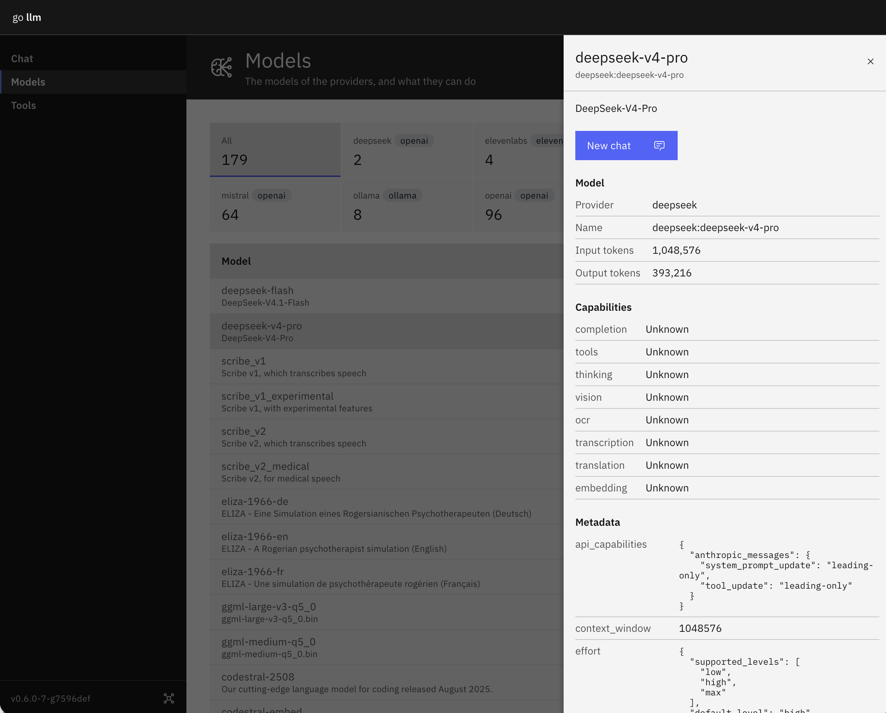

# go-llm

[](https://pkg.go.dev/github.com/mutablelogic/go-llm)
[](LICENSE)

go-llm is an application that puts language and speech models from many providers behind one interface, with a web UI, a command-line tool and a Go SDK. Add providers such as Ollama, LM Studio, OpenAI, Anthropic, Google Gemini, Mistral, [go-whisper](https://github.com/mutablelogic/go-whisper) and ElevenLabs. Then ask any of their models to reply, call tools, search the web, set reminders, run agents, embed, read documents, speak, and transcribe or translate speech. Connect remote MCP servers, such as GitHub, Linear or Notion, so your assistant can use their tools too. You can do all of this through the REST API, the web UI, the `llm` command (which includes a terminal chat), or from Go.

**[Read the manual](https://djthorpe.gitbook.io/go-llm)** to get started.

## Quick Start

> [!WARNING]
> **Don't run go-llm on the internet.** It has no authentication yet, so anyone who can reach it can use your API keys, read your chats, memory and files, and run its tools. Publish its port on `localhost` only, as below, or put it behind a proxy that signs people in, or a VPN.

```bash
docker volume create llm

docker run -d --name llm -p 127.0.0.1:8084:8084 -v llm:/data \
  -e OLLAMA_ADDR=http://host.docker.internal:11434 \
  -e OPENAI_API_KEY \
  ghcr.io/mutablelogic/llm
```

Then open [http://localhost:8084/](http://localhost:8084/), and add a conversation:



For the command line:

```bash
go install -tags client github.com/mutablelogic/go-llm/cmd/llm@latest
llm models
llm ask --model gpt-4o-mini "Explain a KV cache in two sentences"
```

See [Getting Started](https://djthorpe.gitbook.io/go-llm/getting-started) for Docker Compose, adding providers, and running without Docker.

## Documentation

The [manual](https://djthorpe.gitbook.io/go-llm) has:

- [Features](https://djthorpe.gitbook.io/go-llm/features): what go-llm does.
- [Getting Started](https://djthorpe.gitbook.io/go-llm/getting-started): running it, the command line, and its commands.
- [Conversations and Tasks](https://djthorpe.gitbook.io/go-llm/conversations-and-tasks): chat, memory, and scheduled tasks.
- [Workspaces](https://djthorpe.gitbook.io/go-llm/workspaces): files, and the planned Workspace.
- [Models and Providers](https://djthorpe.gitbook.io/go-llm/models-and-providers): providers, capabilities and voices.
- [Tools and Agents](https://djthorpe.gitbook.io/go-llm/tools-and-agents): tools, connectors and agents.
- [Messaging](https://djthorpe.gitbook.io/go-llm/messaging): Telegram, and voice notes.
- [API](https://djthorpe.gitbook.io/go-llm/api): the REST API, and the [Go API reference](https://pkg.go.dev/github.com/mutablelogic/go-llm).
- [Development](https://djthorpe.gitbook.io/go-llm/development): building, testing, the architecture, and the Go packages.
- [Feedback & Issues](https://djthorpe.gitbook.io/go-llm/feedback-and-issues): reporting bugs, and asking for features.

Its pages are in [docs](docs).

## Roadmap

What's planned is in the [issue list](https://github.com/mutablelogic/go-llm/issues), by milestone:

- **[1.6](https://github.com/mutablelogic/go-llm/milestone/3): Make it work.**
- **[1.7](https://github.com/mutablelogic/go-llm/milestone/2): Add authentication and a workspace,** with sign-in, API keys and webhooks, and a Workspace of resources, files and connectors' resources.
- **[1.8](https://github.com/mutablelogic/go-llm/milestone/1): Assistant capabilities and permissions,** such as channels, scheduled agents, more speech and OCR, and approval before the assistant acts.

## License

go-llm is licensed under the [Apache License, Version 2.0](LICENSE).
