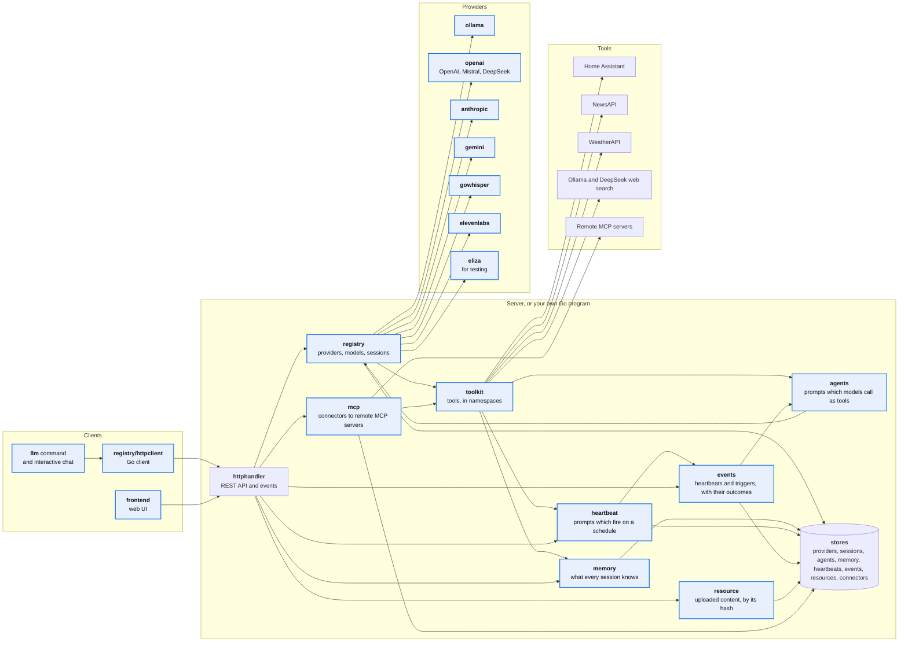

# go-llm

[](https://pkg.go.dev/github.com/mutablelogic/go-llm)
[](LICENSE)

go-llm is an application that puts language and speech models from many providers behind one interface, with a web UI, a command-line tool and a Go SDK. Add providers such as Ollama, OpenAI, Anthropic, Google Gemini, Mistral, [go-whisper](https://github.com/mutablelogic/go-whisper) and ElevenLabs. Then ask any of their models to reply, call tools, search the web, set reminders, run agents, embed, read documents, speak, and transcribe or translate speech. Connect remote MCP servers, such as GitHub, Linear or Notion, so your assistant can use their tools too. You can do all of this through the REST API, the web UI, the `llm` command (which includes a terminal chat), or from Go.

## Quick Start

### 1. Run go-llm, with Docker

The image has the application and its web UI, and keeps its data in the `/data` volume.

> [!WARNING]
> **Don't run go-llm on the internet.** It has no authentication yet, so anyone who can reach it can use your API keys, read your chats, memory and files, and run its tools. Publish its port on `localhost` only, as below, or put it behind a proxy that signs people in, or a VPN.

```bash
# A volume for go-llm's data, which is kept when the container is replaced
docker volume create llm

docker run -d --name llm -p 127.0.0.1:8084:8084 -v llm:/data \
  -e OLLAMA_ADDR=http://host.docker.internal:11434 \
  -e OPENAI_API_KEY \
  ghcr.io/mutablelogic/llm
```

Then open [http://localhost:8084/](http://localhost:8084/):


- **`host.docker.internal`** is the machine Docker runs on, such as for a local Ollama. Docker Desktop has it; on Linux add `--add-host=host.docker.internal:host-gateway`.
- **On first start,** go-llm adds the Eliza provider (unless `NO_ELIZA` is set), and a provider for each of these that's set:
  - `OLLAMA_ADDR` and `GOWHISPER_ADDR`, as URLs;
  - `OPENAI_API_KEY`, `ANTHROPIC_API_KEY`, `GEMINI_API_KEY`, `DEEPSEEK_API_KEY`, `MISTRAL_API_KEY` and `ELEVENLABS_API_KEY`.

  Keys are read from the environment when they're used, never stored.
- **Connectors:** GitHub, Asana, Harvey, HubSpot, PagerDuty and Zoom are offered under **Add connector** when go-llm starts with your OAuth app's credentials for them, such as `GITHUB_CLIENT_ID` and `GITHUB_CLIENT_SECRET`. The other well-known connectors need none. See [Connectors](#connectors).
- **`UID` and `GID`** set the user it runs as, such as the owner of a mounted `/data` directory.

Or use Docker Compose. The [compose file](docker/compose.yaml) lists every variable the server reads. The port is published on `localhost` only, unless `LLM_BIND` says otherwise. Two profiles add servers whose models go-llm can use:

- **`ollama`:** an Ollama server. Set `OLLAMA_ADDR` too, so go-llm adds it as a provider.
- **`whisper`:** a [go-whisper](https://github.com/mutablelogic/go-whisper) server, which transcribes speech, such as Telegram voice messages. Set `GOWHISPER_ADDR` too.

```bash
OLLAMA_ADDR=http://ollama:11434 GOWHISPER_ADDR=http://whisper:8081 \
  docker compose -f docker/compose.yaml --profile ollama --profile whisper up -d
```

### 2. Install the command-line tool

The web UI is all you need to chat. The `llm` command is for working from the terminal, and for automation:

- **Scripts, cron jobs and CI:** ask a model, transcribe a recording, or read a document, then use the output in a pipeline.
- **Files from the shell:** attach them with `--attach`, or pipe text into commands such as `llm speak`.
- **Setup:** add providers, connectors and agents from a script, so an installation can be set up again.
- **Chat in the terminal,** which follows other clients of the same conversation.

```bash
go install -tags client github.com/mutablelogic/go-llm/cmd/llm@latest
```

It needs Go 1.21 or later. go.mod asks for Go 1.27.2, which Go downloads itself, unless `GOTOOLCHAIN=local` is set.

Or run `make client` in a clone, which builds `build/llm`. The tool connects to `localhost:8084`, or the server at `--http.addr` or `LLM_ADDR`, such as `LLM_ADDR=nas.local:8084`.

### 3. Add providers

Add more providers in the web UI, with **Add provider** on the Models page, or with the CLI:

- **API keys** are given by the *name* of the server's environment variable, so the key itself is never stored or sent.
- **URLs** are as the server sees them, not the machine running `llm`. `host.docker.internal` is for a server in Docker; without Docker, use `http://localhost:11434`.

```bash
llm provider-create-ollama http://host.docker.internal:11434
llm provider-create-openai --api-key-credential OPENAI_API_KEY
llm provider-create-anthropic --api-key-credential ANTHROPIC_API_KEY
llm provider-create-gemini --api-key-credential GEMINI_API_KEY
llm provider-create-mistral --api-key-credential MISTRAL_API_KEY
llm provider-create-deepseek --api-key-credential DEEPSEEK_API_KEY
llm provider-create-gowhisper http://host.docker.internal:8081
llm provider-create-elevenlabs --api-key-credential ELEVENLABS_API_KEY
llm provider-create-eliza                   # a mock chatbot, for testing, when NO_ELIZA skipped it at first start

llm providers
llm models
llm models --capability image_input,tools   # models that see images and call tools
llm models --capability speech_output       # models that speak
```

### 4. Ask, and chat

Chat in the web UI, with **Add conversation** on the Conversations page, or with the CLI. With the CLI, a command's model is remembered until you give another:

```bash
llm ask --model gpt-4o-mini "Explain a KV cache in two sentences"

# Files: text is sent as text, images and PDFs as attachments
llm ask --attach main.go "What does this do?"
llm ask --model gpt-4o -a chart.png -a notes.md "Do these agree?"

# Upload a file once, and refer to it by its URI
llm resource-create report.pdf
llm ask -a resource:///<hash> "What does this say?"

llm embed --model mistral-embed "A cat asleep in the sun"
llm ocr --model mistral-ocr-latest report.pdf
llm speak --model ollama:phonon:latest --voice Freya -o hello.wav "Hello, world"
llm transcribe --model voxtral-mini-latest --opt speakers=true --format srt talk.m4a
llm translate --model whisper-1 interview.wav
llm model-load ollama:llama3.2
```

Or chat in a session, which go-llm keeps, and which the web UI shows too:

```bash
llm session-create --model ollama:llama3.2 --system "Be brief" --tools "weatherapi:*"
llm chat                                        # in the terminal
llm chat "Will it rain in Berlin tomorrow?"     # once
llm session-messages
llm sessions
llm session-update --trace                      # show its thinking, and the tools it calls
```

A chat shows what the tools log, and that the model is thinking. Its thinking, and the tools it calls and their results, are shown only when it's traced, in the terminal and the web UI. They're always kept.

Connect a session to Telegram, to chat from your phone. Set `TELEGRAM_BOT_TOKEN`, give the session the `messaging` tools, and ask. You get a link to open, or a QR code in the web UI. See [Messaging](#messaging):

```bash
llm session-create --model ollama:llama3.2 --tools "messaging:*"
llm chat "Let's talk on Telegram"
```

### Without Docker

```bash
go install github.com/mutablelogic/go-llm/cmd/llm@latest
llm run
```

The server listens on `localhost:8084` and keeps its data in your cache directory.

- **No web UI:** installed this way, it serves only the API, under `/api`, so `http://localhost:8084/` says "not found". Use the CLI, or the API.
- **With the web UI:** run `make` in a clone, which builds both, with npm, into `build/llm`.

## Architecture



- **CLI** ([cmd/llm](cmd/llm)): runs the application, and is its client, with a command for each operation and a terminal chat that follows other clients of the same session. It uses the Go client in [registry/httpclient](registry/httpclient).
- **Web UI** ([frontend](frontend)): chat, browse models and tools, and manage providers, connectors and agents. Built in with `make`.
- **Registry** ([registry](registry)): finds a model by name, checks what it can do, and asks its provider. It keeps providers, sessions and agents, runs the agent loop, and publishes events. Sessions unchanged for 14 days (`--session.retention`) are deleted, unless a heartbeat keeps them.
- **Toolkit** ([toolkit](toolkit)): the tools models can call, in namespaces such as `weatherapi`, with their logs and progress streamed.
- **Memory** ([memory](memory)): what every session knows about the person and the assistant, such as names, location and time zone, plus memories kept under keys. Each message is sent to the model with its time, in the person's time zone, rather than putting the time in the system prompt, so prompts can be cached.
- **Heartbeats** ([heartbeat](heartbeat)): prompts that fire once or on a schedule, such as reminders or a morning briefing, in the person's time zone.
- **Compaction** ([registry](registry)): keeps a long conversation within its model's context. Earlier messages are summarized by the built-in `compact` agent, which also updates memories and the title. It happens on request, or automatically above 80% of the context.
- **Events** ([registry](registry)): what happens when a heartbeat fires, or a trigger arrives at `POST /api/llm/event`. The `event` agent decides whether to alert, notify or ignore. Worth-telling outcomes are delivered into the conversation once it's idle, and to its channels.
- **Resources** ([resource](resource)): uploaded content, such as images, documents and audio, kept once by SHA-256 and referred to as `resource:///<hash>`.
- **Agents**: named prompts with a model, tools and input and reply schemas, which models call as tools. Yours are in the `agent` namespace, such as `agent:segment`. The built-in ones, in the [agents](agents) folder, are in `builtin`, such as `builtin:translate`, and only their model can be changed. In a chat, the `llm:agent` tool lists and gets yours and the built-in ones, and creates and updates yours.
- **Connectors** ([mcp](mcp)): remote MCP servers whose tools become a namespace of the toolkit. See [Connectors](#connectors).
- **Providers** ([provider](provider)): each wraps a provider's API.

The registry also works on its own, from your own Go program; see [examples](examples).

## Features

- **Web-based application**: chat, with replies streamed and files attached; browse models and tools; and add providers, connectors and agents, all in the browser. Every page follows changes as they happen.
- **Providers**: add, change and remove them while go-llm runs. Refer to a model by name, or by provider and name, such as `ollama:llama3.2:latest`.
- **Ask**: a reply to messages, with a system prompt, options, tools, and structured output, optionally streamed.
- **Chat**: conversations go-llm keeps, with their model, system prompt, tools and options.
  - The model calls tools until it replies, and long chats are trimmed or compacted to fit.
  - Every client of a session sees new messages, and who's typing.
  - A chat can switch models, such as from Claude to Gemini and back.
  - Attachments a model can't take become notes it can pass to a tool, such as `llm:transcribe`.
- **Agents**: prompts with their own model, tools and schemas, kept as YAML or JSON, that models call as tools, nested as deep as needed.
- **Embed, OCR, speak, illustrate, transcribe and translate**: vectors; document text as Markdown; speech in a chosen voice; images from Gemini's Nano Banana models; and transcripts with speakers, or as subtitles.
- **Models**: download, delete and unload them where the provider stores them, such as Ollama and go-whisper, and list them by [capability](#capabilities).
- **Tools**: Home Assistant, NewsAPI, WeatherAPI, Ollama's and DeepSeek's web search, and any remote MCP server through [connectors](#connectors).
- **Memory**: facts about the person and the assistant, and memories with versions, kept as files you can edit.
- **Resources**: uploaded or generated files, streamed to and from the store, kept once, and downloadable in ranges.
- **Heartbeats**: scheduled prompts with cron expressions, which follow the person's time zone and survive restarts.
- **Messaging**: talk to your assistant on Telegram. See [Messaging](#messaging).
- **Events**: a stream of changes to providers, models, sessions, memory, heartbeats and connectors.
- **OpenAPI and OpenTelemetry**: a described REST API (`llm openapi`), and traces through the registry, providers and tools.

## Providers

| Type | Provider | Generate | Embed | OCR | Transcribe | Translate | Speak | Images | Models |
|------|----------|:--------:|:-----:|:---:|:----------:|:---------:|:-----:|:------:|--------|
| `ollama` | [Ollama](https://ollama.com) | ✅ | ✅ | ✅ (images) | | | ✅ (phonon) | | Download, delete, unload |
| `openai` | [OpenAI](https://platform.openai.com) | ✅ | ✅ | | ✅ | ✅ (whisper) | ✅ (tts) | | |
| `anthropic` | [Anthropic](https://www.anthropic.com), with exact token counts | ✅ | | | | | | | |
| `gemini` | [Google Gemini](https://ai.google.dev), with exact token counts | ✅ | ✅ (text, images, audio, PDFs) | | ✅ | | ✅ (tts) | ✅ (Nano Banana) | |
| `openai` | [Mistral](https://mistral.ai), at `https://api.mistral.ai/v1` | ✅ | ✅ | ✅ | ✅ | | | | |
| `openai` | [DeepSeek](https://www.deepseek.com), and other OpenAI-compatible servers | ✅ | | | | | | | |
| `gowhisper` | [go-whisper](https://github.com/mutablelogic/go-whisper) | | | | ✅ | ✅ | | | Download, delete |
| `elevenlabs` | [ElevenLabs](https://elevenlabs.io) | | | | ✅ | | | | |
| `eliza` | A mock of Weizenbaum's 1966 chatbot, for testing | ✅ | | | | | | | |

What a model can do depends on the model, as its provider reports it. Requests for something a model is known not to do are rejected before they're sent.

### Capabilities

The web UI's Models page shows each model's capabilities as tags, and a model's panel says Yes, No or Unknown for each one. `llm models --capability`, `GET /api/llm/model?capability=` and the `llm:models` tool list models by capability. A capability the provider doesn't report isn't assumed.

| Capability | Meaning |
|------------|---------|
| `chat` | Replies to messages |
| `tools` | Calls tools |
| `thinking` | Reasons before replying |
| `image_input`, `audio_input`, `video_input`, `document_input` | Takes images, audio, video or documents in a conversation |
| `image_output` | Makes images |
| `speech_output` | Speaks text |
| `embedding` | Embeds text and media |
| `ocr` | Reads the text in images and documents |
| `transcription`, `translation` | Transcribes speech, or translates it into English |

## CLI Commands

| Group | Commands |
|-------|----------|
| Server | `run`, `openapi` |
| Providers | `providers`, `provider`, `provider-create-ollama`, `provider-create-openai`, `provider-create-anthropic`, `provider-create-gemini`, `provider-create-mistral`, `provider-create-deepseek`, `provider-create-gowhisper`, `provider-create-elevenlabs`, `provider-create-eliza`, `provider-update`, `provider-delete` |
| Models | `models`, `model`, `model-load`, `model-delete`, `model-unload` |
| Sessions | `sessions`, `session`, `session-messages`, `session-create`, `session-update`, `session-forget`, `session-compact`, `session-delete` |
| Inference | `ask`, `chat`, `embed`, `ocr`, `transcribe`, `translate`, `speak`, `illustrate` |
| Tools and agents | `namespaces`, `tools`, `tool`, `call`, `agents`, `agent`, `agent-create`, `agent-update`, `agent-delete` |
| Connectors | `connectors`, `connector`, `connector-create`, `connector-update`, `connector-delete` |
| Memory | `details`, `detail-set`, `detail-forget`, `memories`, `memory`, `memory-remember`, `memory-forget` |
| Heartbeats | `heartbeats`, `heartbeat`, `heartbeat-create`, `heartbeat-update`, `heartbeat-delete` |
| Resources | `resources`, `resource`, `resource-create`, `resource-get`, `resource-delete` |
| Events | `events` |

Run `llm <command> --help` for its flags. Model options are given with `--opt`, such as `--opt temperature=0.2`. These options control the agent loop rather than the model:

| Option | Default | Meaning |
|--------|---------|---------|
| `max_iterations` | 10, or 3 for `ask` | How many times the model is asked before it must reply |
| `max_depth` | 3 | How deeply agents can call agents |
| `tool_timeout` | `30s` | How long a tool has to return |

## Connectors

Connectors are remote MCP servers whose tools your assistant can call. Each connector's tools are a namespace of their own, such as `linear:list_issues`.

- **Prompts are agents:** a server's MCP prompts are agents in its namespace, such as `github:review_pr`, beside its tools. They run with the model of the chat that calls them, and can't be changed or deleted. A prompt's name becomes an identifier, so `review-pr` is `review_pr`.

- **Adding one:** in the web UI, use **Add connector** on the Tools page. It lists well-known servers such as GitHub, Linear, Notion and Stripe, plus **Custom connector** for any URL. From the CLI, run `llm connector-create <url>`.
- **Signing in:** if the server needs sign-in, you'll get a **Sign in** button, or the CLI opens your browser. The server keeps the token and refreshes it.
- **Your own client:** some servers, such as GitHub's, don't register clients themselves. For those, set your OAuth app's ID and secret in the server's environment, such as `GITHUB_CLIENT_ID` and `GITHUB_CLIENT_SECRET`, and register the redirect URL that the connector panel's Advanced section shows with your app.
  - A well-known server's connector, from **Add connector**, already has the names of those credentials.
  - A custom connector needs them: in the panel's **Advanced** section, or with `llm connector-create --client-id-credential GITHUB_CLIENT_ID --client-secret-credential GITHUB_CLIENT_SECRET <url>`.
- **Behind a reverse proxy:** run the server with `--tls.name=<public host>`, so sign-in sends browsers back to the public address.
- **Storage:** connectors are kept in `connectors.json`, and their tokens in `credentials.json`. Only remote servers, over streamable HTTP or SSE, are supported.

The API is documented in [mcp/registry/httphandler/README.md](mcp/registry/httphandler/README.md).

## Tools

Tools are added when their credentials or settings are present:

| Namespace | Tools | Needs |
|-----------|-------|-------|
| `memory` | Remember details about the person and the assistant; search, keep and forget memories | Always added |
| `heartbeat` | Schedule, list, update and cancel heartbeats | Always added |
| `llm` | `models`, `speak`, `illustrate`, `ocr`, `transcribe` and `resource`: list models by capability, speak, make images, read documents, transcribe, and list or read the chat's files as Markdown | Always added |
| `weatherapi` | Current weather, forecasts and alerts | `WEATHERAPI_API_KEY`, from [weatherapi.com](https://www.weatherapi.com/signup.aspx) |
| `newsapi` | News articles, headlines and sources | `NEWSAPI_API_KEY`, from [newsapi.org](https://newsapi.org/register) |
| `homeassistant` | Query, search and control smart home devices | `HOMEASSISTANT_URL`, `HOMEASSISTANT_API_KEY` |
| `ollama` | Web search and fetch, with Ollama's cloud | `OLLAMA_API_KEY`, from [ollama.com](https://ollama.com/settings/keys) |
| `deepseek` | Web search and fetch, with DeepSeek's | `DEEPSEEK_API_KEY`, from [platform.deepseek.com](https://platform.deepseek.com/api_keys), the same key as its models |
| `messaging` | `connect`, `list`, `send` and `disconnect` chats, such as on Telegram. See [Messaging](#messaging) | `TELEGRAM_BOT_TOKEN`, from [BotFather](https://t.me/BotFather) |
| *a connector's* | The tools of a remote MCP server. See [Connectors](#connectors) | A connector |

Give a model tools by name (`weatherapi:current`), by namespace (`weatherapi:*`), or all of them (`*`).

Web search costs money:

- **Ollama:** free up to a monthly quota, then charged. Once the quota is used up, its calls fail.
- **DeepSeek:** charged per search and per fetch, about $0.75 per 1,000 successful calls. Calls that fail or find nothing aren't charged.
- **Choosing:** with both keys set, both namespaces are added. Give a chat one of them, such as `deepseek:*`, to choose which it uses.

Notes on the `llm` tools:

- **Preferred models:** each tool uses the model the person chose for that capability, which it remembers in the memory as `preferred_models`, or asks them to choose.
- **Voice notes:** `speak` with `format: voice-note` makes Ogg Opus voice notes, for Telegram. Models that can't make them need `opusenc`, from [opus-tools](https://opus-codec.org/downloads/), which the Docker image includes.
- **Files they make:** speech and images are kept as the chat's files. OCR text is only kept when a `name` or `title` is given. A transcript is only kept when a `format`, `name` or `title` is given, or it's longer than 8 KB, when only its start is returned and the rest is read with `resource`.
- **Reading files:** `resource` reads text, HTML, CSV, PDFs, Word, OpenDocument, EPUB, spreadsheets, emails, calendars, subtitles and more, with [go-metadata](https://github.com/mutablelogic/go-metadata). It reads a part at a time, carrying on where the last part ended.

## Messaging

Connect chats on messaging services to a conversation, so you can talk to your assistant from your phone. Telegram is the first:

1. Make a bot with [BotFather](https://t.me/BotFather), and set its token as `TELEGRAM_BOT_TOKEN`.
2. In a chat whose model has the `messaging` tools, ask to talk on Telegram. You get a link, valid once for 15 minutes, which the web UI also shows as a QR code.
3. Open the link, or scan the code, and press Start.

### Channels

- **Both ways:** what you say on Telegram goes to the conversation. Every reply, and every heartbeat outcome worth telling you, goes to all its channels.
- **Where it was sent:** in the web UI, a Telegram message shows where it was sent, and who sent it, in a grey line under it.
- **More than one:** a conversation can have several chats, such as yours and a group's. A chat belongs to one conversation, so connecting it again moves it.
- **Groups:** everyone in a connected group can talk to the assistant and see what it remembers about you. Only connect groups whose people you'd tell.
- **Who said it:** each message says where it came from and who sent it, so the assistant can tell people apart.
- **Ignored:** messages from chats that aren't connected are ignored.

### Running the bot

- **No public address needed:** the server reads the bot's messages by long polling.
- **One server per bot:** don't share a bot's token between servers.
- **Progress:** while a reply takes a while, the chat shows what's happening in one message, which is deleted when the reply arrives.

### Replies

- **Formatting:** Markdown is converted to Telegram's: headings become bold, lists get bullets, and tables are monospaced. Long replies are split between paragraphs.
- **Files:** pictures and speech a reply makes are sent with it, with the reply as the caption. Images go as photos, Ogg audio as voice messages, MP3 and M4A as tracks, and anything else as documents, up to 50 MB. Other files, such as transcripts, are only sent with `messaging:send`.
- **Voice:** in a conversation with channels, the assistant is told to speak in `voice-note` format and to transcribe voice messages it can't hear. See [Voice notes](#voice-notes).

### Voice notes

To talk to your assistant by voice, it needs a model that speaks and one that transcribes. With the compose file's `ollama` and `whisper` profiles, these run locally. Download them once:

```bash
llm model-load ollama:phonon:latest          # speaks
llm model-load gowhisper:ggml-medium-q5_0    # transcribes
```

- **Tell the assistant which to use,** such as "speak with `ollama:phonon:latest`, and transcribe with `gowhisper:ggml-medium-q5_0`". It remembers.
- **Speaking:** replies are sent as Ogg voice notes. Models that can't make them need `opusenc`, which the Docker image includes.
- **Transcribing:** `ggml-medium-q5_0` runs on small machines, such as a Jetson Nano, but can mishear names. `ggml-large-v3-turbo-q5_0` hears them better, on a faster machine.
- **Other models:** `llm models --capability speech_output` lists the models that speak, such as OpenAI's and Gemini's. OpenAI, Gemini, Mistral and ElevenLabs also transcribe.

### Files you send

- **Kept with the conversation:** photos, documents, voice messages, audio and video become the conversation's files, as if dropped into the web UI. A caption becomes the message's text and the files' description.
- **Albums** arrive as one message.
- **Compressed photos** say so, so the assistant can ask for the original.
- **Over 20 MB:** bots can't download files this large, so the assistant is told it didn't get them.
- **Names:** files without a name are named by kind and time, such as `voice-note-2026-11-08-1035.ogg`, and audio and video descriptions include their length.

## API

The REST API is under `/api`, and `llm openapi` shows it as OpenAPI. Streaming operations, such as ask and transcribe, send server-sent events when `text/event-stream` is accepted. Each part is documented beside its handlers:

- [registry](registry/httphandler/README.md): providers, models, sessions, agents and inference;
- [events](broadcaster/httphandler/README.md);
- [memory](memory/httphandler/README.md);
- [heartbeats](heartbeat/httphandler/README.md);
- [resources](resource/httphandler/README.md);
- [connectors](mcp/registry/httphandler/README.md).

## Go

The packages work on their own, without the application:

- [`llm`](https://pkg.go.dev/github.com/mutablelogic/go-llm): the interfaces of providers and models (`Generator`, `Embedder`, `Measurer`, `Recognizer`, `Transcriber`, `Speaker`, `Illustrator`, `Downloader`) and their options.
- [`provider/...`](provider): a client for each provider.
- [`registry`](registry): finds models, asks them, and keeps providers, sessions and agents, with HTTP handlers and a client.
- [`toolkit`](toolkit): the tools models call.
- [`memory`](memory), [`heartbeat`](heartbeat), [`messaging`](messaging): namespaces of the toolkit, with stores, and HTTP handlers or runners.
- [`mcp/...`](mcp): remote MCP clients, the connector registry, and connectors' tools as namespaces. [`auth/httpclient`](auth/httpclient) discovers how a resource is signed in to.
- [`broadcaster`](broadcaster): publishes events, and streams them as server-sent events.

The registry is meant to be composed into a larger system. Its options plug in what that system has:

- **`WithProviderStore`, `WithSessionStore`, `WithAgentStore`:** keep providers, sessions and agents in a store, such as a database. Each item has a serial, so a stale change is a conflict, and stores can watch for other servers' changes.
- **`WithCredentialsProvider`:** expands an API key's placeholder, such as `${OPENAI_KEY}`, from the environment by default, or from a secrets manager. It's a [`credentials.Provider`](auth/credentials), which the toolkit and the connectors take too, so a system shares one.
- **`WithToolkit`:** the tools models can call.
- **`WithBroadcaster`:** shares an event stream with other modules.
- **`WithTracer`, `WithClientOpts`:** trace and configure requests to providers.

The `llm` command, in [cmd/llm](cmd/llm), is one such system. The [examples](examples) use the packages directly, with Ollama (`OLLAMA_ADDR`), OpenAI (`OPENAI_API_KEY`), or Eliza:

| Example | What it does |
|---------|--------------|
| [ask](examples/ask) | Ask a question, and stream the reply |
| [tools](examples/tools) | Your own tool, which the model calls |
| [chat](examples/chat) | Chat in the terminal |
| [agent](examples/agent) | Run an agent that replies with JSON |
| [ocr](examples/ocr) | Read an image or PDF as Markdown |
| [transcribe](examples/transcribe) | Transcribe or translate speech |

```bash
go run ./examples/ask "Explain a KV cache in two sentences"
```

## Development

```bash
make vet race-test TEST_FLAGS=-short   # as CI runs the tests
make test                              # all tests, with coverage
```

Tests that call a provider are skipped with `-short`, or when its key or address isn't set.

### Tests with live models

Live tests check that a provider's API accepts what go-llm sends. They're mostly `Test_Live…` tests in each provider's package, and run when their variable is set and `-short` isn't:

| Variable | Package | What's tested | Billed |
|----------|---------|---------------|:------:|
| `OPENAI_API_KEY` | `provider/openai` | Replies with tools, embeddings, transcription, translation and speakers | Yes |
| `MISTRAL_API_KEY` | `provider/openai` | Replies, embeddings, OCR and transcription | Yes |
| `ANTHROPIC_API_KEY` | `provider/anthropic` | Replies with tools, thinking and structured output, and token counts | Yes |
| `GEMINI_API_KEY` | `provider/gemini` | Model listing and token counts (free), embeddings, and a tool call | Yes, apart from listing and counting |
| `ANTHROPIC_API_KEY` and `GEMINI_API_KEY` | `provider/gemini` | `Test_LiveSwitch`: a chat that switches between Claude and Gemini | Yes |
| `ELEVENLABS_API_KEY` | `provider/elevenlabs` | Transcription with speakers, and the account's voices (free) | Yes, apart from voices |
| `OLLAMA_ADDR` | `provider/ollama` | Models, embeddings and OCR, with `embeddinggemma-2` and `deepseek-ocr` pulled | No |
| `GOWHISPER_ADDR` | `provider/gowhisper` | Models and transcription, with `ggml-medium-q5_0` | No |

Model names can be changed with variables such as `OPENAI_MODEL` and `OLLAMA_OCR_MODEL`. Run one provider's live tests with `-count=1 -v`:

```bash
GEMINI_API_KEY=... go test -count=1 -v -run Live ./provider/gemini/
```

The billed tests use the cheapest models and cost a fraction of a cent, but `make test` runs them whenever your shell has the keys. Keep them out with `-short`, or unset the keys:

```bash
make test TEST_FLAGS=-short
env -u OPENAI_API_KEY -u MISTRAL_API_KEY -u ANTHROPIC_API_KEY -u GEMINI_API_KEY -u ELEVENLABS_API_KEY go test ./...
```

## Roadmap

### Sessions

- **A model for summaries:** a cheaper model writes compaction summaries, rather than the session's own.

### Agents and tools

- **Connectors:** MCP prompts and resources, as well as tools.
- **Channels**, beyond what Telegram does now:
  - **locations:** shared places told to the model, setting the person's location and time zone, and sending places as map pins;
  - **replies:** what a message replies to, so "this one" means something;
  - **groups:** replying only when the assistant is mentioned or replied to;
  - **commands:** `/new`, `/stop`, `/forget` and `/status` in Telegram's menu;
  - **more of Telegram:** recording indicators, editing and deleting the assistant's messages, reactions, and buttons;
  - **voice messages** transcribed as they arrive, with the chat's default model;
  - channels in the web UI, and Slack.
- **What each model takes,** in `llm:models`: voices, formats, what OCR reads, and image aspect ratios, with errors that say what's accepted.
- **Default models for each chat:** a model per capability, set once in a chat, rather than kept in memory.
- **Scheduled runs in the chat:** a heartbeat's prompt goes to the chat's own model, with recent runs, rather than only to the `event` agent.
- **Scheduled agents:** agents that run on a schedule.
- **Running Python** (experimental): a sandboxed WebAssembly tool that reads and writes the session's files.

### Server

- **Authentication and authorization** across the API, web UI, CLI, connectors and channels: sign-in with OIDC or API tokens, and roles or scopes for what each person or client can do.
- **A database, and more than one server:** shared providers, sessions, agents, memory, heartbeats and resources.
- **External volumes for resources:** mount folders, such as from your own filesystem, so their files are resources the assistant can read.
- **Usage:** account for each session's use, in tokens, time or cost.

### Providers

- **LM Studio**, with its own model management API.
- **ElevenLabs' voices** for text to speech.
- **OpenAI's images** with `gpt-image`.
- **OpenAI's Responses API**, so the newest models can think while calling tools.
- **OpenAI's token limits**, which need checking.

### Improvements

- **OCR:** `glm-ocr` with Ollama; PDFs with Ollama's image models, page by page; and images inside documents.
- **Speech:** speakers with go-whisper's diarizing model; live transcription over a WebSocket; translation with models that hear audio, such as Voxtral Small; and subtitle lengths.
- **Files:** UTF-16 text ([#192](https://github.com/mutablelogic/go-llm/issues/192)); audio and video metadata; and Markdown parts that end at a heading or paragraph ([go-metadata#20](https://github.com/mutablelogic/go-metadata/issues/20)).

## License

go-llm is licensed under the [Apache License, Version 2.0](LICENSE).
