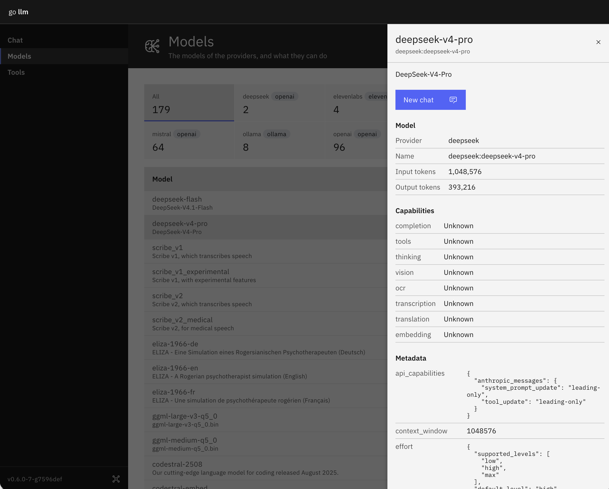

# go-llm

go-llm puts language and speech models from many providers behind one interface, with a web UI, a command-line tool and a Go SDK.

- **Providers:** Ollama, LM Studio, OpenAI, Anthropic, Google Gemini, Mistral, DeepSeek, go-whisper and ElevenLabs.
- **What models do:** reply, call tools, search the web, set reminders, run agents, embed, read documents, speak, and transcribe or translate speech.
- **Connectors:** remote MCP servers, such as GitHub, Linear or Notion, whose tools your assistant can use.
- **Where:** the web UI, the `llm` command (with a terminal chat), the REST API, or your own Go program.


**Don't run go-llm on the internet.** It has no authentication yet, so anyone who can reach it can use your API keys, read your conversations, memory and files, and run its tools. Keep it on `localhost`, or behind a proxy that signs people in, or a VPN.


## Where to start

- [Features](features.md): what go-llm does.
- [Installation](installation.md): run it with Docker, and install the command line.
- [Getting Started](getting-started.md): add providers, and start a conversation.
- [Conversations and Tasks](conversations-and-tasks.md): chat, memory, and scheduled tasks.

The source is at [github.com/mutablelogic/go-llm](https://github.com/mutablelogic/go-llm), under the Apache License 2.0.
