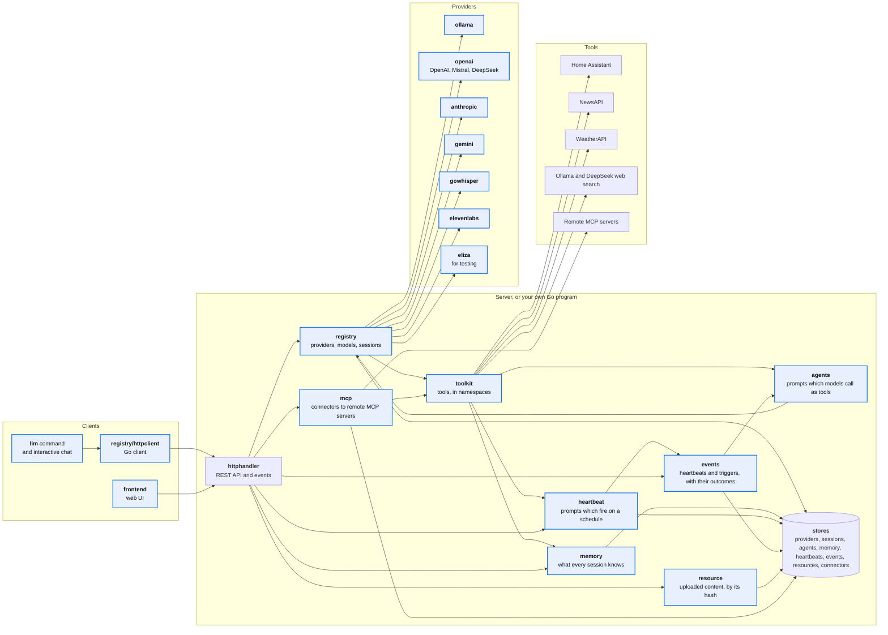

# Development

## Building

```bash
make                 # the server, with the web UI, into build/llm
make client          # the command line only
```

The web UI is built with npm, from the `frontend` folder, with Lit and IBM's Carbon components.

## Testing

```bash
make vet race-test TEST_FLAGS=-short   # as CI runs the tests
make test                              # all tests, with coverage
```

### Live tests

Live tests check that a provider's API accepts what go-llm sends. They run when their variable is set, and `-short` isn't:

| Variable | Package | Billed |
|----------|---------|:------:|
| `OPENAI_API_KEY` | `provider/openai` | Yes |
| `MISTRAL_API_KEY` | `provider/openai` | Yes |
| `ANTHROPIC_API_KEY` | `provider/anthropic` | Yes |
| `GEMINI_API_KEY` | `provider/gemini` | Yes, apart from listing and counting |
| `ELEVENLABS_API_KEY` | `provider/elevenlabs` | Yes, apart from voices; speaking only with `ELEVENLABS_SPEAK` |
| `OLLAMA_ADDR` | `provider/ollama` | No |
| `GOWHISPER_ADDR` | `provider/gowhisper` | No |
| `LMSTUDIO_ADDR` | `provider/lmstudio` | No |

The billed tests use the cheapest models, and cost a fraction of a cent, but `make test` runs them whenever your shell has the keys. Keep them out with `-short`, or unset the keys.

## Architecture



- **[`registry`](https://github.com/mutablelogic/go-llm/tree/main/registry):** finds a model by name, checks what it can do, and asks its provider. It keeps providers, conversations and agents, runs the agent loop, and publishes events.
- **[`toolkit`](https://github.com/mutablelogic/go-llm/tree/main/toolkit):** the tools models call, in namespaces.
- **[`provider`](https://github.com/mutablelogic/go-llm/tree/main/provider):** a client for each provider.
- **[`memory`](https://github.com/mutablelogic/go-llm/tree/main/memory), [`heartbeat`](https://github.com/mutablelogic/go-llm/tree/main/heartbeat), [`messaging`](https://github.com/mutablelogic/go-llm/tree/main/messaging):** namespaces of the toolkit, with their stores.
- **[`resource`](https://github.com/mutablelogic/go-llm/tree/main/resource):** files, kept by their hash.
- **[`mcp`](https://github.com/mutablelogic/go-llm/tree/main/mcp):** remote MCP clients, and connectors.
- **[`cmd/llm`](https://github.com/mutablelogic/go-llm/tree/main/cmd/llm):** the server, and the command line.

## Using the packages

The Go API reference is at [pkg.go.dev/github.com/mutablelogic/go-llm](https://pkg.go.dev/github.com/mutablelogic/go-llm).

The registry is meant to be composed into a larger system. Its options plug in what that system has:

- **`WithProviderStore`, `WithSessionStore`, `WithAgentStore`:** keep providers, conversations and agents in a store, such as a database. Each item has a serial, so a stale change is a conflict, and stores can watch for other servers' changes.
- **`WithCredentialsProvider`:** expands an API key's placeholder, such as `${OPENAI_KEY}`, from the environment by default, or from a secrets manager.
- **`WithToolkit`:** the tools models can call.
- **`WithBroadcaster`:** shares an event stream with other modules.
- **`WithTracer`, `WithClientOpts`:** trace, and configure, requests to providers.

The [examples](https://github.com/mutablelogic/go-llm/tree/main/examples) use the packages directly, with Ollama (`OLLAMA_ADDR`), OpenAI (`OPENAI_API_KEY`), or Eliza:

| Example | What it does |
|---------|--------------|
| [ask](https://github.com/mutablelogic/go-llm/tree/main/examples/ask) | Ask a question, and stream the reply |
| [tools](https://github.com/mutablelogic/go-llm/tree/main/examples/tools) | Your own tool, which the model calls |
| [chat](https://github.com/mutablelogic/go-llm/tree/main/examples/chat) | Chat in the terminal |
| [agent](https://github.com/mutablelogic/go-llm/tree/main/examples/agent) | Run an agent that replies with JSON |
| [ocr](https://github.com/mutablelogic/go-llm/tree/main/examples/ocr) | Read an image or PDF as Markdown |
| [transcribe](https://github.com/mutablelogic/go-llm/tree/main/examples/transcribe) | Transcribe or translate speech |


```bash
go run ./examples/ask "Explain a KV cache in two sentences"
```

## Contributing

Please open an issue first, so a change can be discussed. See [Feedback & Issues](feedback-and-issues.md).
